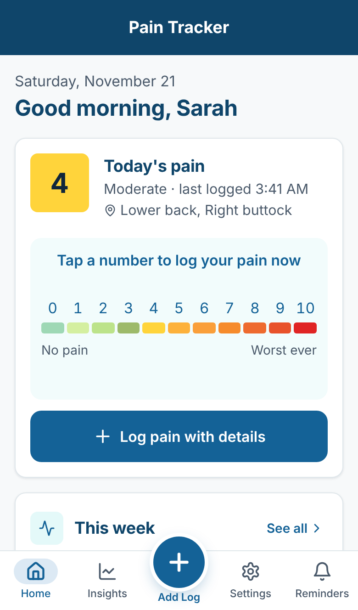
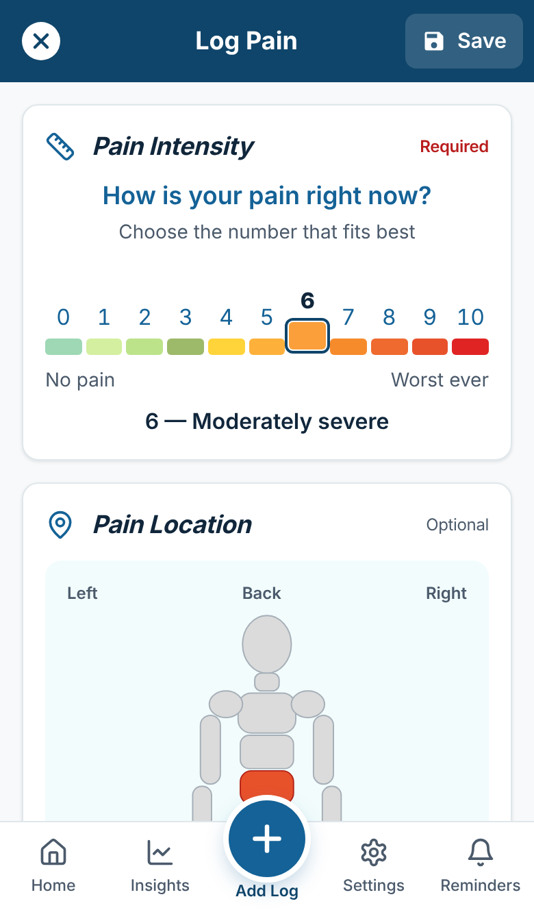
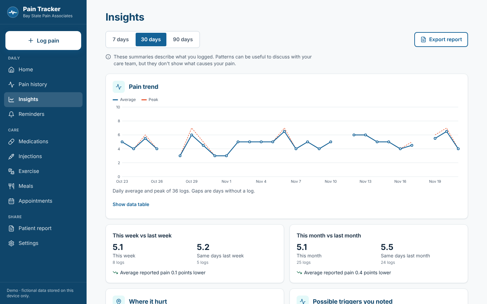

# Bay State Pain Tracker — patient app for Bay State Pain Associates

**[Try the live app ↗](https://hebamoussa.com/pain-tracker/)** · **[Read the case study ↗](https://hebamoussa.com/work/bay-state-pain-tracker-app)** · **[Portfolio](https://hebamoussa.com)**

<p>
  
  
  
</p>

      

A responsive, installable Progressive Web App for patients of Bay State Pain Associates. It turns the
**PainTrack / Bay State Pain app** concept (Heba Moussa, DGM6268, Fall 2025) into working software: one-tap
pain logging, medications, injections, exercise, meals, reminders, insights and a PDF report for appointments.

> **Demo only.** Ships with fictional data for “Sarah”, the case study's illustrative persona. Everything is stored in
> the browser on the device. It isn't connected to the clinic, it isn't HIPAA-compliant, and you shouldn't enter real
> health information.

## Quick start

```bash
git clone https://github.com/hmyes2021/bay-state-pain-tracker.git
cd bay-state-pain-tracker
npm install
npm run dev          # http://localhost:5174
```

Production build, which is needed to test the service worker, offline mode and install:

```bash
npm run build
npm run preview      # http://localhost:4173
```

Tests:

```bash
npm test             # unit + component tests (Vitest)
npm run test:e2e     # browser journeys on iPhone, Pixel, iPad and desktop (needs `npm run preview` running)
```

`test:e2e` uses the Playwright library. If it isn't installed locally, run it with `NODE_PATH=$(npm root -g)`, or
install `playwright` as a dev dependency. Screenshots, PDFs and `results.json` go to `e2e/output/`.

## Hosting

The live version runs at **[hebamoussa.com/pain-tracker](https://hebamoussa.com/pain-tracker/)**, built with
`BASE_PATH=/pain-tracker/` and hash URLs (`/pain-tracker/index.html#/insights`) so deep links and reloads work on a
static host. Its service worker is scoped to that folder.

To host it yourself with normal URLs, run `BASE_PATH=/your-path/ npm run build` and set up a single-page-app fallback
to `index.html`. For a static host without that fallback, add `VITE_ROUTER=hash`.

## Configuration

Copy `.env.example` to `.env.local`. With the defaults (`VITE_DATA_BACKEND=local`) the app makes no network
requests for data. The font is self-hosted, and there is no analytics and no third-party script.

## Design system: preserved from the original

The tokens in `src/styles/tokens.css` were **sampled from the original prototype screens** and the
[PainTrack case study](https://hebamoussa.com/work/bay-state-pain-app):

| Token | Value | Source |
|---|---|---|
| `--navy` | `#0F456A` | Title bars (“Log Pain”, “Reminders”), headings |
| `--primary` | `#146297` | “Finish Setup” button, active chips, toggles |
| `--accent-soft` / `--accent-wash` | `#E4F9F9` / `#F2FCFC` | Goal icon tiles, body-map panel, reminder preview |
| `--surface` | `#F7F9FA` | App background, preference rows |
| `--danger-soft` | `#FEF2F2` | “Discard” button |
| `--success`, `--danger`, `--line` | `#7FC8A9`, `#EF4444`, `#E0E7EB` | Design-system palette (Success / Error / Neutral) |
| Pain scale | green → yellow → red | Prototype intensity bar |
| Spacing / radii | 4/8/16/24/32/48 · 4/8/12/16 | Design-system tokens slide |
| Type | Inter, 300–800 | Prototype typography scale |

To improve contrast without changing the brand: text uses `-ink` variants (for example success text `#166D4C`,
error text `#B91C1C`, secondary text `#4B5A6B`), all at ≥ 4.5:1. The original teal and green colours are kept for fills.

Patterns carried over from the prototype: the navy title bar with **✕ / title / Save**, the welcome screen
(“What should we call you?” and six goal tiles), the body map with Front/Back toggle, the “How is your pain right
now?” 0–10 bar, collapsible detail cards (“Activity at Time of Pain ⌄”), the **Save before closing?** dialog
(Complete & Save / Save Draft / Discard / Cancel), “How often?” frequency chips, Sound/Vibration switches, the
**Reminder preview** card, the profile card (Records / Day Streak), and the bottom navigation with a floating “+”.

What changed, and why:
- **Mobile navigation** follows the brief: Home · Insights · **Add Log** · Settings · Reminders.
- **Desktop and tablet** get a navy sidebar and multi-column layouts. Tablets keep the bottom nav with wider cards.
- **Body map** is redrawn as an accessible SVG. Each region is a keyboard-operable checkbox, and the side labels are
  from the patient's point of view.
- **Icons** use Lucide line icons in the brand blue, close to the prototype's solid icon set. Supply the original
  icon set or the official clinic logo (SVG) to swap them in.
- **Name:** the prototype was called *PainTrack*. This build is *Pain Tracker*, per the brief.

## Features implemented

- **Home:** greeting, today's pain, **one-tap logging** (tap a number, saved instantly with Undo), detailed Log Pain
  button above the fold, today's medication doses, recent entries, upcoming appointments, exercise this week, weekly
  summary chart, links to the other trackers.
- **Pain log:** required 0–10 scale, then optional details. Front/back body map, characteristics, duration,
  triggers (presets + custom), sleep and activity impact, notes with opt-in voice-to-text, editable timestamp. Save
  drafts, resume them, edit and delete entries (with Undo). "Save before closing?" dialog.
- **Medications:** name, prescribed dosage, schedule (Daily / every 12 h / every 8 h / as needed / custom times),
  instructions, prescriber. Taken / skipped / missed per dose, as-needed doses, side-effect notes, a 14-day history
  with filters, an optional linked reminder, and a "currently taking" switch. No titration logic.
- **Injections:** type, date, body location, provider, pain before and after, patient-rated effectiveness, notes, and
  the average of the patient's own logs in the two weeks before and after.
- **Exercise:** type, duration, pain before and after, difficulty, notes, weekly totals.
- **Meals:** meal type, description, water glasses, optional symptoms.
- **Appointments:** add, edit and delete, with an optional reminder the evening before.
- **Insights:** 7 / 30 / 90-day filters. Pain trend (simplified on phones; average + peak on desktop), week and
  month comparisons, body locations, noted triggers, sleep vs reported pain, medication records, exercise history,
  treatment history. Each chart has a data-table alternative and "pattern, not cause" wording.
- **Reminders:** medication, pain-log, exercise, appointment and custom types. Multiple times; daily, weekday,
  selected-day or one-off schedules; sound and vibration; live preview; test send; pause; notification permission
  with an in-app fallback.
- **Patient report:** choose a period and sections, add questions, preview, download a PDF generated on the device,
  and share it via the system share sheet where supported.
- **Settings:** profile, records hub, notifications, voice opt-in, install instructions per platform, privacy
  summary, JSON export, demo reset, delete everything.
- **PWA:** manifest, icons (including maskable), app shortcuts, precached offline shell, offline banner, update
  prompt, install prompt / iOS instructions.
- **Quality:** loading skeletons, error boundary with data recovery, load-error retry, storage-full messages,
  44 px+ touch targets, skip link, focus moves to the page heading on navigation, native `<dialog>` focus trapping,
  reduced-motion support.

## Architecture

```
src/
  app/          AppShell (nav, title bar), AppStore (state, optimistic saves), App (routes, gate), ErrorBoundary
  components/   UI library: Card, Collapsible, ChipGroup, Segmented, Switch, Stepper, Dialog, TextField, Badge, charts, Toast
  features/     pain (PainScale, BodyMap, regions), meds (DoseRow), records (shared list + form page)
  pages/        Home, LogPain, History, Insights, Reminders, Settings, Medications, Treatments, Exercise, Meals, Appointments, Report, Onboarding
  logic/        Pure functions: insights, medication schedule, reminder scheduling, report building + PDF
  data/         models.ts (types), demoData.ts (fictional seeded data)
  storage/      DataAdapter interface, LocalAdapter (demo), SupabaseAdapter (integration-ready, off)
  auth/         AuthProvider interface + demo session, role permissions matrix
  hooks/        install prompt, speech, reminders runner, media queries, online status
supabase/schema.sql   Tables + row-level-security policies mirroring auth/permissions.ts
e2e/journeys.mjs      Browser journeys + axe accessibility scans
```

The UI talks only to `useStore()`. The store talks only to a `DataAdapter`, so swapping on-device storage for a
backend needs no UI changes.

## Safety and privacy decisions

- A consent screen with three required acknowledgements runs before any data is created. You can review it in Settings.
- **No medication titration:** schedules mirror what the patient enters, and overdue doses are never marked “missed”
  automatically.
- Insights describe what was logged and say on screen that patterns don't establish causes.
- Voice-to-text is **opt-in**. The disclosure explains that some browsers process speech on their own servers.
- PDFs are generated in the browser and nothing is uploaded. Every page is labelled “patient-reported”.
- Data export (JSON), demo reset, and permanent deletion of all data and consent are in Settings.
- Crisis copy: “In an emergency, call 911.”

## Integrations that still need production development

See `TESTING.md` → “Not production-ready yet”.
